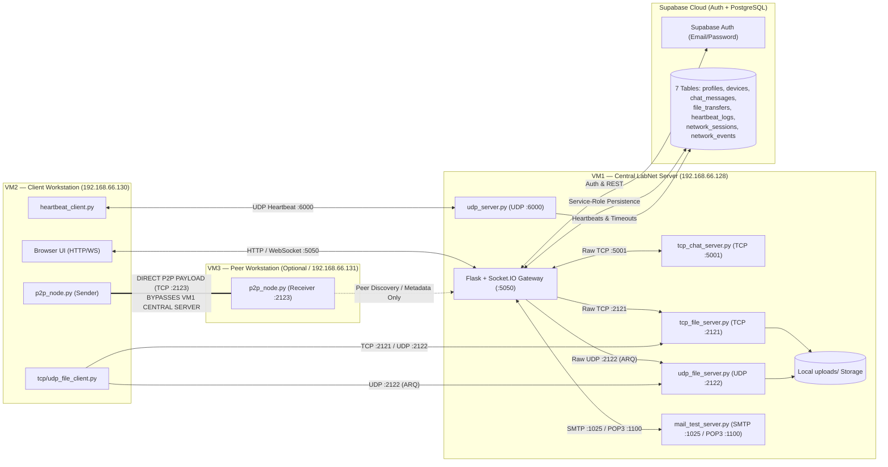

# LabNet — Multi-Protocol Network for Research Resource Sharing and Communication

## 1. Project Overview
**LabNet** is a genuine, low-level BSD socket-based Computer Networks platform built for university research laboratories running on Ubuntu Linux virtual machines over a VMware virtual LAN (`192.168.66.0/24`). It combines real transport-layer networking (multithreaded TCP chat, chunked TCP file transfer, reliable sliding-window ARQ UDP file transfer, UDP heartbeat monitoring, direct peer-to-peer workstation file streaming, local SMTP/POP3 mail services, DNS client lookup, and ICMP/kernel diagnostics) with a modern Flask + Socket.IO control portal backed by Supabase Auth and PostgreSQL.

## 2. Problem Statement
University research labs require reliable inter-workstation communication, verifiable large dataset sharing, and real-time node availability tracking over local private networks without depending on external cloud relays for bulk payloads. Conventional web dashboards often simulate networking logic in JavaScript rather than exercising real OS-level TCP/UDP sockets.

## 3. Objectives
- Implement real BSD socket servers and clients (`AF_INET`, `SOCK_STREAM`, `SOCK_DGRAM`) across multiple VMs.
- Separate real-time socket transport (TCP `:5001`) from durable conversation persistence (Supabase `chat_messages`) so offline nodes retrieve missed messages upon reconnection.
- Build a genuine reliable transport protocol over UDP (Sliding-Window ARQ with sequencing, ACKs, timeout retransmissions, out-of-order reassembly, and SHA-256 verification).
- Demonstrate direct peer-to-peer workstation transfers whose payload completely bypasses the central server.
- Enforce real role-based authentication (`student` vs `admin`) via Supabase Auth and PostgreSQL RLS.

## 4. System Architecture (Mermaid)



## 5. Network Topology
- **Subnet:** `192.168.66.0/24` (VMware Virtual LAN)
- **VM1 (Primary Server):** `192.168.66.128`
- **VM2 (Client Workstation):** `192.168.66.130` (verify dynamically with `ip -br addr`)
- **VM3 (Optional Peer Node):** Independent workstation IP running `clients/p2p_node.py --listen --port 2123`

## 6. Technology Stack
- **Transport & Socket Programming:** Python 3.10+ (`socket`, `threading`, `hashlib`, `smtplib`, `poplib`, `subprocess`)
- **Web Gateway & Real-Time UI:** Flask 3.1, Flask-SocketIO 5.7, HTML5, CSS3 (editorial serif + Inter light SaaS UI), Vanilla JavaScript, FontAwesome 6, Custom SVG branding
- **Database & Authentication:** Supabase Auth + PostgreSQL (7 tables with RLS & `on_auth_user_created` trigger)

## 7. Protocol Implementations
| Protocol | Implementation | Key Mechanism |
| :--- | :--- | :--- |
| **TCP Broadcast Chat** | `server/tcp_chat_server.py` | Multithreaded `SOCK_STREAM`, `\n`-delimited JSON framing, Supabase history persistence |
| **TCP File Transfer** | `server/tcp_file_server.py` | Handshake + 64 KB binary chunk stream + real-time SHA-256 verification |
| **Reliable UDP File Transfer** | `server/udp_file_server.py` + `clients/udp_file_client.py` | Sliding-Window ARQ (`window=5`), 1024 B chunks, selective ACKs, timeout retransmissions, out-of-order reassembly, SHA-256 verification |
| **UDP Heartbeat** | `server/udp_server.py` + `clients/heartbeat_client.py` | Periodic `HEARTBEAT|id|ts` datagrams, RTT tracking, configurable timeout (`10s`), automatic offline transition & recovery |
| **Direct P2P Transfer** | `clients/p2p_node.py` | Coordinator peer discovery (`/api/peers/*`), direct workstation-to-workstation TCP socket stream bypassing VM1 |
| **HTTP** | `web/app.py` | Authenticated REST APIs, Socket.IO gateway, secure path-traversal-protected file downloads |
| **DNS (Client Demo)** | `server/dns_service.py` | Genuine host resolver A/AAAA/PTR lookup & latency measurement |
| **SMTP & POP3 (Local Spool)** | `server/mail_test_server.py`, `smtp_service.py`, `pop3_service.py` | RFC 5321 SMTP submission (`:1025`) & RFC 1939 POP3 mailbox retrieval (`:1100`) with full command transcripts |
| **ICMP & Kernel Diagnostics** | `web/services/monitoring_service.py` | Safe subprocess execution of `ping`, `traceroute`, `ip route`, `ip -br addr`, `ss -tuln` |

## 8. Port Allocation
| Port | Protocol | Service |
| :---: | :---: | :--- |
| **5050** | TCP / HTTP | Flask Web Portal & Socket.IO Gateway (`web/app.py`) |
| **5001** | TCP | Multithreaded Broadcast Chat Server (`server/tcp_chat_server.py`) |
| **2121** | TCP | Chunked TCP File Server (`server/tcp_file_server.py`) |
| **2122** | UDP | Reliable Sliding-Window ARQ UDP File Server (`server/udp_file_server.py`) |
| **2123** | TCP | Direct Peer-to-Peer Listener (`clients/p2p_node.py`) |
| **6000** | UDP | UDP Heartbeat & Echo Monitor (`server/udp_server.py`) |
| **5000** | TCP | Persistent Multi-Message TCP Echo (`server/tcp_server.py`) |
| **1025** | TCP | Local RFC 5321 SMTP Test Spool (`server/mail_test_server.py`) |
| **1100** | TCP | Local RFC 1939 POP3 Test Mailbox (`server/mail_test_server.py`) |
| **53** | UDP | Host DNS Resolver (queried by `server/dns_service.py`) |

## 9. Database Architecture
LabNet persists live activity across seven Supabase PostgreSQL tables documented in [docs/DATABASE_SCHEMA_REFERENCE.md](docs/DATABASE_SCHEMA_REFERENCE.md):
1. `profiles` (`id`, `display_name`, `role` in `['admin','student']`, `created_at`)
2. `devices` (`id`, `user_id`, `device_name`, `hostname`, `ip_address`, `os`, `status` in `['online','offline']`, `last_seen_at`, `created_at`)
3. `chat_messages` (`id`, `sender_user_id`, `sender_device_id`, `message`, `protocol`, `status`, `sent_at`)
4. `file_transfers` (`id`, `sender_user_id`, `sender_device_id`, `receiver_device_id`, `file_name`, `file_size`, `protocol`, `checksum`, `storage_path`, `status`, `started_at`, `completed_at`)
5. `heartbeat_logs` (`id`, `device_id`, `received_at`, `latency_ms`, `source_ip`)
6. `network_sessions` (`id`, `source_device_id`, `destination_device_id`, `protocol`, `source_port`, `destination_port`, `status`, `started_at`, `ended_at`, `bytes_sent`, `bytes_received`)
7. `network_events` (`id`, `device_id`, `event_type`, `protocol`, `source_ip`, `destination_ip`, `details`, `created_at`)

## 10. Authentication Workflow
- Public registration (`/login` → Create Account) calls Supabase Auth `sign_up` and strictly assigns the `student` role via the database trigger `on_auth_user_created`.
- Admin privileges cannot be self-selected in the UI; promote trusted administrators on VM1 using:
  ```bash
  .venv/bin/python scripts/manage_users.py promote <email>
  ```
- Backend routes enforce `@login_required` and `@admin_required` (re-verifying `profiles.role` against Supabase).

## 11. Installation & 12. Environment Variables
```bash
git clone https://github.com/Divya-Asnani/labnet-network.git
cd labnet-network
python3 -m venv .venv
source .venv/bin/activate
pip install -r requirements.txt
cp .env.example .env
# Edit .env with your SUPABASE_URL, SUPABASE_ANON_KEY, SUPABASE_SERVICE_ROLE_KEY
```
Never commit `.env` to Git (`.env` is enforced in `.gitignore`).

## 13. VM1 Setup & 15. Exact Service Startup Commands
On **VM1 (`192.168.66.128`)**, open 5 terminal tabs:
```bash
cd ~/Desktop/CNT_CP/labnet-network && source .venv/bin/activate

# Tab 1: TCP Chat Server (:5001)
python server/tcp_chat_server.py

# Tab 2: TCP File Server (:2121)
python server/tcp_file_server.py

# Tab 3: Reliable UDP File Server (:2122)
python server/udp_file_server.py

# Tab 4: UDP Heartbeat Server (:6000)
python server/udp_server.py

# Tab 5: Flask Portal + Local SMTP (:1025) & POP3 (:1100) (:5050)
python web/app.py
```

## 14. VM2 Setup & 16. Cross-VM Testing
On **VM2** (verify IP with `ip -br addr`):
```bash
cd ~/Desktop/CNT_CP/labnet-network
git pull origin main
source .venv/bin/activate
pip install -r requirements.txt

# 1. Start UDP Heartbeat client (normal + simulated missed heartbeats)
python clients/heartbeat_client.py --server 192.168.66.128 --port 6000 --id "VM2-Workstation" --interval 2

# 2. Stream a file over TCP (:2121)
python clients/tcp_file_client.py sample.bin 192.168.66.128 2121 Student

# 3. Stream a file over Reliable UDP (:2122) with 20% simulated packet loss
python clients/udp_file_client.py sample.bin --server 192.168.66.128 --port 2122 --loss-rate 0.20

# 4. Direct P2P Receiver (:2123)
python clients/p2p_node.py --listen --port 2123 --name "VM2-Peer" --dir p2p_received

# 5. Browser Portal
# Open http://192.168.66.128:5050/login
```

## 17. Automated Validation Suites
```bash
source .venv/bin/activate
python test/test_phase1_phase2.py
python test/test_phase3_phase4_phase5.py
python test/test_final_validation.py
```

## 18. Known Limitations
- **Local Mail Demonstration:** SMTP (:1025) and POP3 (:1100) operate against a local in-memory laboratory spool; external Internet email delivery is intentionally not configured.
- **DNS Client Demonstration:** DNS lookups use the host's configured stub resolver (`/etc/resolv.conf`) rather than hosting a full authoritative DNS server.
- **Chat Channel Scope:** The existing `chat_messages` schema stores shared broadcast channel messages (no `recipient_user_id` column). Participant filtering is provided in the UI without modifying the existing table schema.
- **VM3 Availability:** Direct P2P transfer has been verified locally between independent socket processes (`:2123`) and documented for cross-VM VM2 ↔ VM3 execution when a third VM is provisioned.

See [docs/ARCHITECTURE.md](docs/ARCHITECTURE.md), [docs/NETWORK_PROTOCOLS.md](docs/NETWORK_PROTOCOLS.md), [docs/DATABASE_SCHEMA_REFERENCE.md](docs/DATABASE_SCHEMA_REFERENCE.md), and [docs/TESTING_GUIDE.md](docs/TESTING_GUIDE.md) for full details.
