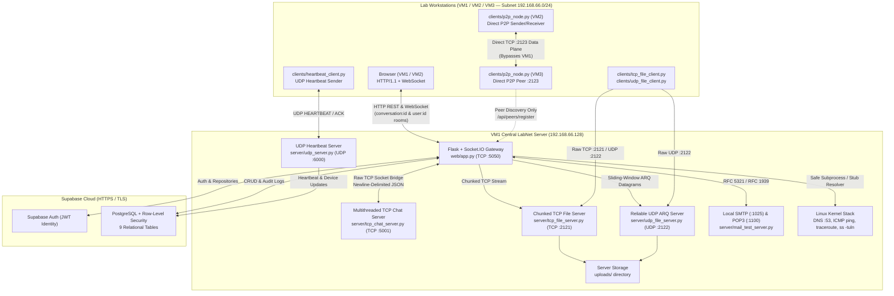

# LabNet — Complete System Understanding, CNT Concepts & Page-by-Page UI Guide

> **Project:** LabNet — A Multi-Protocol Network for Research Resource Sharing and Communication  
> **Repository:** `labnet-network`  
> **Network Topology:** VMware Virtual LAN (`192.168.66.0/24`) — VM1 Server (`192.168.66.128`), VM2 Client (`192.168.66.130`), optional VM3 Peer (`192.168.66.131`)  
> **Stack:** Python 3.10 (`socket`, `threading`, `hashlib`, `subprocess`), Flask, Flask-SocketIO, Supabase Auth & PostgreSQL (with Row-Level Security), HTML5/CSS3/Vanilla JavaScript

---

## Table of Contents

1. [What LabNet Is & System Overview](#1-what-labnet-is--system-overview)
2. [End-to-End Architecture & Protocol Interaction](#2-end-to-end-architecture--protocol-interaction)
3. [Complete Port & Service Map](#3-complete-port--service-map)
4. [Computer Networks (CNT) Theory From Scratch — Every Protocol in LabNet](#4-computer-networks-cnt-theory-from-scratch--every-protocol-in-labnet)
   - [4.1 OSI & TCP/IP Layers, IP Addressing, Sockets & Ports](#41-osi--tcpip-layers-ip-addressing-sockets--ports)
   - [4.2 TCP — Connection-Oriented Reliable Byte Stream (:5000, :5001, :2121)](#42-tcp--connection-oriented-reliable-byte-stream-5000-5001-2121)
   - [4.3 UDP — Connectionless Datagrams, Heartbeats (:6000) & Sliding-Window ARQ (:2122)](#43-udp--connectionless-datagrams-heartbeats-6000--sliding-window-arq-2122)
   - [4.4 Client-Server vs Direct Peer-to-Peer (P2P) Topology (:2123)](#44-client-server-vs-direct-peer-to-peer-p2p-topology-2123)
   - [4.5 HTTP/1.1 REST vs WebSockets / Socket.IO (:5050)](#45-http11-rest-vs-websockets--socketio-5050)
   - [4.6 DNS — Domain Name System Resolution (UDP :53)](#46-dns--domain-name-system-resolution-udp-53)
   - [4.7 Electronic Mail: Push (SMTP :1025) vs Pull (POP3 :1100)](#47-electronic-mail-push-smtp-1025-vs-pull-pop3-1100)
   - [4.8 Network Layer & Linux Kernel Diagnostics (ICMP, Routing, Passive Socket Table)](#48-network-layer--linux-kernel-diagnostics-icmp-routing-passive-socket-table)
   - [4.9 Security, Authentication (JWT/RBAC) & Private Conversation Isolation (RLS)](#49-security-authentication-jwtrbac--private-conversation-isolation-rls)
5. [Supabase PostgreSQL Data Model (All 9 Tables)](#5-supabase-postgresql-data-model-all-9-tables)
6. [Page-by-Page Walkthrough of the Main UI](#6-page-by-page-walkthrough-of-the-main-ui)
7. [How to Make a Professor Account an Admin](#7-how-to-make-a-professor-account-an-admin)
8. [Viva / Examiner Q&A Quick Reference](#8-viva--examiner-qa-quick-reference)

---

## 1. What LabNet Is & System Overview

**LabNet** is a real, multi-protocol research laboratory networking platform built on top of genuine **BSD socket programming in Python** across multiple Ubuntu Virtual Machines, paired with a modern web control portal and cloud-backed PostgreSQL persistence.

Unlike simulated classroom demos that fake progress bars or only use HTTP REST calls, LabNet implements **actual transport-layer and application-layer network protocols** running on real listening ports:

- **Real-time private 1-to-1 chat** bridged through a multithreaded **raw TCP socket server (`:5001`)** with strict conversation isolation in Supabase PostgreSQL + Socket.IO rooms.
- **Three distinct file-transfer modes** so users can directly compare networking paradigms:
  1. **Chunked TCP File Transfer (`:2121`)** — reliable byte stream with SHA-256 verification.
  2. **Reliable UDP File Transfer (`:2122`)** — custom **Sliding-Window Selective-Repeat ARQ** built from scratch over unreliable UDP datagrams (with live packet-loss simulation & retransmission).
  3. **Direct Peer-to-Peer (P2P) Transfer (`:2123`)** — workstation-to-workstation data plane that bypasses the central VM1 server for file bytes while VM1 handles peer discovery only.
- **Live workstation presence & liveness monitoring** combining **UDP Heartbeat datagrams (`:6000`)** with RTT latency tracking and **browser WebSocket presence**, plus automatic server-side offline timeout detection.
- **Core Internet & Linux networking services**: **HTTP/1.1**, **WebSockets**, **DNS client (`:53`)**, local **RFC 5321 SMTP (`:1025`)** & **RFC 1939 POP3 (`:1100`)** mail servers/clients, and real **ICMP / kernel routing / socket diagnostics** (`ping`, `traceroute`, `ip route`, `ip -br addr`, `ss -tuln`).
- **Role-based authentication (`student` vs `admin`)** powered by Supabase Auth and PostgreSQL Row-Level Security (RLS).

---

## 2. End-to-End Architecture & Protocol Interaction



### Why Does Chat Use BOTH WebSockets AND Raw TCP Sockets?

A very common question in Computer Networks evaluations is: *"Why is Flask-SocketIO used if LabNet is a raw TCP socket project?"*

1. **Browser Security Sandboxing:** Modern web browsers (Chrome, Firefox, Safari) intentionally prohibit JavaScript from opening arbitrary raw TCP (`SOCK_STREAM`) or UDP (`SOCK_DGRAM`) sockets directly — otherwise any malicious website could port-scan your internal LAN. Browsers only speak **HTTP** and **WebSockets**.
2. **Genuine Raw TCP Backbone:** Rather than faking chat inside Flask memory, LabNet uses a **two-hop gateway architecture**:
   - **Hop 1 (Browser ↔ Flask `:5050`):** Full-duplex WebSocket (`Socket.IO`) carries the user's message to the authenticated Flask server.
   - **Hop 2 (Flask ↔ TCP Chat Server `:5001`):** `web/services/tcp_service.py` maintains a real persistent `socket.socket(socket.AF_INET, socket.SOCK_STREAM)` connection to `server/tcp_chat_server.py`. Every message is serialized into a newline-delimited JSON frame, transmitted across the raw TCP byte stream, broadcast by the TCP server to connected TCP clients (including CLI `clients/tcp_chat_client.py` nodes), received back by the bridge, verified for conversation membership, and emitted **strictly** to the authorized `conversation:<uuid>` Socket.IO room.
3. **Persistence Separately in PostgreSQL:** Before dispatching on the TCP socket, Flask writes the message to Supabase `chat_messages` tied to its `conversation_id`, so offline users can load full conversation history when they log in later.

---

## 3. Complete Port & Service Map

| Port | Transport | Service Name | Implementation File | Role in LabNet |
| :--- | :--- | :--- | :--- | :--- |
| **`5050`** | TCP | Flask + Socket.IO Web Portal | `web/app.py` | Main UI, REST APIs, WebSocket gateway, authenticated downloads, peer discovery |
| **`5000`** | TCP | Legacy TCP Echo Server | `server/tcp_server.py` | Foundational multithreaded TCP request/reply server (preserved from Phase 1) |
| **`5001`** | TCP | Multithreaded TCP Chat Server | `server/tcp_chat_server.py` | Real-time framed JSON messaging hub supporting concurrent web bridge & CLI clients |
| **`2121`** | TCP | Chunked TCP File Server | `server/tcp_file_server.py` | 64 KB chunked binary file upload server with JSON handshake & SHA-256 verification |
| **`2122`** | UDP | Reliable UDP File Server (ARQ) | `server/udp_file_server.py` | Sliding-window selective-repeat ARQ receiver with out-of-order reassembly & SHA-256 |
| **`2123`** | TCP | Direct Peer-to-Peer (P2P) Node | `clients/p2p_node.py` | Workstation-to-workstation direct file listener/sender (bypasses VM1 for file data) |
| **`6000`** | UDP | UDP Heartbeat Presence Server | `server/udp_server.py` | Receives periodic `HEARTBEAT` datagrams, sends `HEARTBEAT_ACK`, logs latency to Supabase |
| **`1025`** | TCP | Local RFC 5321 SMTP Server | `server/mail_test_server.py` | Educational local mail submission spool (`EHLO/MAIL FROM/RCPT TO/DATA/QUIT`) |
| **`1100`** | TCP | Local RFC 1939 POP3 Server | `server/mail_test_server.py` | Educational local mailbox retrieval (`USER/PASS/STAT/LIST/RETR/QUIT`) |
| **`53`** | UDP | System DNS Resolver (Client) | `server/dns_service.py` | Queries host `/etc/resolv.conf` nameserver for `A`, `AAAA`, and `PTR` records |
| **Layer 3** | ICMP | Kernel Network Diagnostics | `web/services/monitoring_service.py` | Safe subprocess execution of `ping`, `traceroute`, `ip route`, `ip -br addr`, `ss -tuln` |

---

## 4. Computer Networks (CNT) Theory From Scratch — Every Protocol in LabNet

### 4.1 OSI & TCP/IP Layers, IP Addressing, Sockets & Ports

When two applications on different Ubuntu VMs communicate, data travels down the **TCP/IP 4-layer stack** (mapped to the 7-layer OSI model):

| TCP/IP Layer | OSI Equivalent | What It Does | LabNet Examples |
| :--- | :--- | :--- | :--- |
| **4. Application** | Layers 5–7 (Session, Presentation, Application) | Formats user data, APIs, framing, authentication | HTTP/1.1, WebSocket, DNS, SMTP, POP3, LabNet JSON Chat & File Handshake |
| **3. Transport** | Layer 4 (Transport) | Process-to-process delivery via **Port Numbers** (`0–65535`), reliability/multiplexing | **TCP** (`SOCK_STREAM`) and **UDP** (`SOCK_DGRAM`) |
| **2. Internet** | Layer 3 (Network) | Host-to-host logical addressing & routing across subnets | **IPv4** (`192.168.66.0/24`), **ICMP** (`ping`, `traceroute`), Linux routing table |
| **1. Network Access** | Layers 1–2 (Physical, Data Link) | Frame delivery on local LAN segment via MAC addresses | VMware virtual Ethernet NIC (`ens33` / `eth0`), ARP |

**Key Foundational Concepts Used Everywhere in LabNet:**
- **Subnetting (`192.168.66.0/24`):** The `/24` prefix means the first 24 bits (`192.168.66`) identify the local virtual LAN, and the last 8 bits identify hosts (`.1`–`.254`). Because VM1 (`192.168.66.128`) and VM2 (`192.168.66.130`) share the same `/24` prefix, packets travel directly across the virtual switch without needing an external router.
- **Socket Endpoint (`IP:Port`):** An IP address finds the *machine* (VM1), while a **port number** (`5001`, `2121`, `6000`) identifies the *exact server process* inside that machine. Binding a server socket to `0.0.0.0` tells the OS kernel to accept connections arriving on *any* network interface (`127.0.0.1` loopback AND `192.168.66.128` LAN).
- **`SO_REUSEADDR`:** Set on LabNet server sockets so restarting a server doesn't fail with `Address already in use` while previous TCP connections sit in the kernel's `TIME_WAIT` state.

---

### 4.2 TCP — Connection-Oriented Reliable Byte Stream (`:5000`, `:5001`, `:2121`)

#### The CNT Theory
**TCP (RFC 9293)** provides a **reliable, ordered, error-checked byte stream** between two endpoints:
1. **3-Way Handshake (Connection Establishment):**
   - Client sends `SYN` (initial sequence number `x`).
   - Server replies `SYN-ACK` (acknowledges `x+1`, sends its own sequence number `y`).
   - Client sends `ACK` (`y+1`). Only now can application bytes flow.
2. **Reliability & Flow Control:** Every byte is numbered; the receiver returns cumulative `ACK`s and advertises its receive buffer window (`rwnd`). Lost segments trigger retransmission; out-of-order segments are buffered and reassembled invisibly by the OS kernel.
3. **4-Way Teardown:** `FIN → ACK → FIN → ACK` cleanly closes both halves of the full-duplex stream.

#### The Byte-Stream Framing Problem (Crucial CNT Concept!)
TCP has **no concept of "messages."** If a client calls `send("Hello")` followed by `send("World")`, TCP may deliver `"HelloWorld"` in one `recv()` call, or `"Hel"` then `"loWor"` then `"ld"`.

**How LabNet Solves Framing:**
- **In TCP Chat (`server/tcp_chat_server.py`):** Every chat payload is encoded as single-line UTF-8 JSON terminated by `\n` (**newline-delimited JSON framing**). Each client thread accumulates incoming bytes in a string buffer and splits strictly on `\n` before parsing JSON.
- **Concurrency (`server/tcp_chat_server.py`):** The main thread loops on `server_sock.accept()`. For every incoming client, it spawns a dedicated daemon `threading.Thread` and stores the client socket inside a shared dictionary protected by a **`threading.Lock` (mutex)** to prevent race conditions when clients connect/disconnect concurrently.
- **In TCP File Transfer (`server/tcp_file_server.py` & `clients/tcp_file_client.py`):**
  1. **Phase 1 — Metadata Handshake:** Client computes the file's **SHA-256 cryptographic digest** locally and sends a JSON header (`filename`, `filesize`, `sha256`, `sender`, `transfer_id`) terminated by `\n`.
  2. **Phase 2 — Server Readiness:** Server sanitizes the filename (`os.path.basename()` to prevent path traversal), replies `READY\n`.
  3. **Phase 3 — Chunked Binary Streaming:** Client reads the file in **64 KB (`65536` byte) chunks** (`sendall`) so even large files use constant RAM instead of loading the entire file into memory. Progress callbacks emit real transferred byte counts to the browser via Socket.IO.
  4. **Phase 4 — End-to-End Integrity Verification:** Server streams incoming bytes directly to disk in `uploads/` while updating an in-flight `hashlib.sha256()` object. Once `received_bytes == filesize`, it compares `computed_sha256 == expected_sha256` and replies with a JSON verdict (`SUCCESS` or `CHECKSUM_MISMATCH`).

---

### 4.3 UDP — Connectionless Datagrams, Heartbeats (`:6000`) & Sliding-Window ARQ (`:2122`)

#### The CNT Theory
**UDP (RFC 768)** is the opposite of TCP:
- **Connectionless:** No 3-way handshake; packets are fired immediately.
- **Minimal 8-Byte Header:** Source Port, Destination Port, Length, Checksum.
- **Message-Boundary Preserving:** One `sendto()` produces one `recvfrom()` datagram (if it arrives).
- **Best-Effort Only:** The network may drop, duplicate, or reorder UDP datagrams silently.

LabNet uses UDP in **two completely different, classic CNT patterns**:

#### Pattern A: UDP Heartbeat & Liveness Monitoring (`server/udp_server.py`, `clients/heartbeat_client.py`)
Why use UDP instead of TCP for heartbeats? Because keeping thousands of persistent TCP state machines just to ask *"are you alive?"* wastes memory and stalls during half-open network drops.
1. Every few seconds (default 3s), `clients/heartbeat_client.py` sends a small UDP datagram to `192.168.66.128:6000`:
   ```text
   HEARTBEAT|<device_name>|<hostname>|<os>|<client_timestamp>
   ```
2. `server/udp_server.py` immediately replies with `HEARTBEAT_ACK|<server_timestamp>` and upserts the device in Supabase `devices` (`status='online'`, `last_seen_at=now()`), recording a row in `heartbeat_logs`.
3. The client measures **RTT (Round-Trip Time)** in milliseconds: `RTT = (t_ack_received - t_sent) * 1000`.
4. **Automatic Offline Detection:** A background reaper (`enforce_heartbeat_timeouts()` in `web/database/repositories/device_repository.py`, invoked every 5s by `monitoring_service.py`) checks `now - last_seen_at > HEARTBEAT_TIMEOUT` (default `10s`). If a node goes silent (or you test with `--simulate-missed 4`), its status flips automatically from `ONLINE` to `OFFLINE` and a `timeout` event is recorded in `network_events`.

#### Pattern B: Reliable Sliding-Window Selective-Repeat ARQ over UDP (`server/udp_file_server.py`, `clients/udp_file_client.py`)
A centerpiece Computer Networks concept is **how TCP achieves reliability on top of an unreliable network** — by implementing **ARQ (Automatic Repeat reQuest)** at the sender and receiver. LabNet builds a real **Sliding-Window Selective-Repeat ARQ protocol** from scratch in application-layer Python over UDP port `2122`:

```text
Sender (Window Size W = 5)                      Receiver (UDP :2122)
──────────────────────────                      ────────────────────
1. INIT (filename, filesize, total_chunks, sha256) ────────► Allocates session buffer
                                                   ◄──────── INIT_ACK
2. Sends window [seq 0, seq 1, seq 2, seq 3, seq 4]
   seq 0 ──────────────────────────────────────────────────► Buffers seq 0, replies ACK|0
   seq 1 ────────── X  (Simulated 20% Packet Loss!)
   seq 2 ──────────────────────────────────────────────────► Out-of-order! Buffers seq 2, replies ACK|2
   seq 3 ──────────────────────────────────────────────────► Out-of-order! Buffers seq 3, replies ACK|3
   seq 4 ──────────────────────────────────────────────────► Out-of-order! Buffers seq 4, replies ACK|4
3. Retransmission Timer expires for unACKed seq 1!
   seq 1 (RETRANSMIT) ─────────────────────────────────────► Fills gap! Replies ACK|1
4. Window slides forward → [seq 5, seq 6, seq 7, ...]
5. All chunks ACKed → FIN ─────────────────────────────────► Reassembles 0..N-1 in order,
                                                             computes SHA-256, writes uploads/
                                                   ◄──────── FIN_ACK (VERIFIED)
```

**Why Sliding Window (`WINDOW_SIZE = 5`) Beats Stop-and-Wait:**
- In **Stop-and-Wait ARQ**, the sender sends 1 packet and sits completely idle for a full RTT waiting for 1 ACK.
- In **Sliding-Window Selective-Repeat ARQ**, up to $W = 5$ packets are pipelined in flight simultaneously, multiplying channel utilization while **retransmitting only the specific lost packets** (not the whole window like Go-Back-N).
- **Live Proof:** Running `clients/udp_file_client.py sample.bin --server 192.168.66.128 --loss-rate 0.20` intentionally drops 20% of outgoing packets; the protocol automatically detects timeouts, retransmits the lost sequences, drops any duplicates, reassembles out-of-order chunks, and still achieves a **100% matching SHA-256 checksum**!

---

### 4.4 Client-Server vs Direct Peer-to-Peer (P2P) Topology (`:2123`)

- **Client-Server Topology (`:2121`, `:2122`):** All file bytes flow from `VM2 → VM1` and are stored centrally on VM1 (`uploads/`). Simple to manage, but VM1 becomes a bandwidth bottleneck.
- **Hybrid Peer-to-Peer Topology (`clients/p2p_node.py`, port `2123`):** Separates the **Control Plane** from the **Data Plane**:
  1. **Control Plane (Discovery via VM1):** Peer B (e.g., VM3 at `192.168.66.131`) starts `p2p_node.py --listen --port 2123`, which sends an HTTP `POST /api/peers/register` to VM1 announcing its reachable `IP:Port`.
  2. **Data Plane (Direct Workstation-to-Workstation):** Peer A queries `/api/peers/list` (or enters Peer B's IP directly in `/files`), opens a **direct raw TCP socket to `192.168.66.131:2123`**, performs the JSON metadata + SHA-256 handshake, and streams binary chunks straight to Peer B. **Zero file payload bytes traverse VM1's disk or file server.**

---

### 4.5 HTTP/1.1 REST vs WebSockets / Socket.IO (`:5050`)

- **HTTP/1.1 (Stateless Request-Response):** Used for page rendering, authentication (`/api/auth/login`), CRUD fetches (`/api/dashboard/overview`, `/api/files/list`), and binary downloads (`/api/files/download/<id>`). Because HTTP is stateless, identity persists across requests via an **HTTP-only, `SameSite=Lax` signed session cookie**.
- **WebSockets / Socket.IO (Persistent Full-Duplex):** Begins as an HTTP `GET` with `Upgrade: websocket` (`101 Switching Protocols`) and upgrades into a persistent bidirectional TCP channel. LabNet uses it for:
  1. **Instant Chat Push Delivery:** Messages arrive in milliseconds without HTTP polling, strictly scoped to authorized `conversation:<uuid>` rooms.
  2. **Live File-Transfer Progress Events (`file_progress`):** Streams real chunk percentages and retransmission metrics to `/files`.
  3. **Live Browser Presence:** Every authenticated page maintains a Socket.IO connection (`base.html` / `chat.js` / `files.js`) mapped to the workstation's `device_id` (`register_ws_device` / `unregister_ws_device`), keeping the device accurately `ONLINE` while the browser is open and letting it transition to `OFFLINE` on sign-out or tab close.

---

### 4.6 DNS — Domain Name System Resolution (`UDP :53`)

- **CNT Concept:** Humans remember domain names (`google.com`, `localhost`), while IP routing requires 32-bit IPv4 or 128-bit IPv6 addresses. **DNS** is a hierarchical distributed database queried primarily over **UDP port 53**.
- **How LabNet Implements It (`server/dns_service.py`):** LabNet implements a genuine **DNS stub client** (not a full recursive DNS server):
  - Reads the host's configured upstream resolver directly from `/etc/resolv.conf`.
  - Executes real lookups via Python's `socket.getaddrinfo()` (for `A` IPv4 and `AAAA` IPv6 records) and `socket.gethostbyaddr()` (for `PTR` reverse DNS lookups).
  - Measures resolution latency in milliseconds and logs every lookup to Supabase `network_events` (`protocol='DNS'`).

---

### 4.7 Electronic Mail: Push (`SMTP :1025`) vs Pull (`POP3 :1100`)

Why does email need **two** separate application-layer protocols? Because sending mail and reading mail have opposite connectivity requirements:
- **SMTP — Simple Mail Transfer Protocol (RFC 5321, Push Protocol):** Used to **push** outgoing mail from a sender (MUA/client) to a mail server (MTA) using text commands over TCP:
  ```text
  S: 220 labnet.local ESMTP Ready
  C: EHLO labnet-client
  S: 250-labnet.local
  C: MAIL FROM:<researcher@labnet.local>
  S: 250 OK
  C: RCPT TO:<student@labnet.local>
  S: 250 OK
  C: DATA
  S: 354 End data with <CR><LF>.<CR><LF>
  C: Subject: LabNet Alert\r\n\r\nTest body.\r\n.\r\n
  S: 250 OK queued
  C: QUIT
  ```
- **POP3 — Post Office Protocol v3 (RFC 1939, Pull Protocol):** Used by a recipient to **pull** queued mail from their server mailbox on demand over TCP:
  ```text
  S: +OK LabNet POP3 Server Ready
  C: USER student
  S: +OK
  C: PASS labnet
  S: +OK Logged in
  C: STAT        → +OK 2 480  (2 messages, 480 bytes)
  C: LIST        → Lists message numbers and byte sizes
  C: RETR 1      → Downloads full RFC 5322 email text of message #1
  C: QUIT
  ```
- **LabNet Implementation (`server/mail_test_server.py`, `server/smtp_service.py`, `server/pop3_service.py`):** Runs genuine local threaded RFC 5321 SMTP (`:1025`) and RFC 1939 POP3 (`:1100`) servers backed by a local spool directory, plus genuine `smtplib`/`poplib` clients that capture and return the **exact wire-level command/response transcript** in the UI. *(Educational local spool — does not send external Internet emails.)*

---

### 4.8 Network Layer & Linux Kernel Diagnostics (`ICMP`, Routing, Passive Socket Table)

Implemented safely in `web/services/monitoring_service.py` (`run_diagnostic()`):
- **Command-Injection Prevention:** Every command runs via `subprocess.run([binary, arg1, arg2], shell=False)` with strict regex target validation (`^[a-zA-Z0-9.\-:]+$`), never interpolating raw user strings into a shell.
- **Diagnostic Tools & Their CNT Meaning:**
  1. **`ping -c 4 <target>` (ICMP Echo Request / Reply):** Verifies Layer 3 IP reachability, packet loss %, and round-trip latency (min/avg/max/mdev).
  2. **`traceroute -n -m 15 <target>` (ICMP Time Exceeded / TTL Discovery):** Sends probes with `TTL = 1, 2, 3...`. Each intermediate router decrements TTL to `0`, drops the packet, and sends back an ICMP `Time Exceeded` packet revealing every Layer 3 hop along the path.
  3. **`ip route` (Kernel Forwarding / Routing Table):** Displays the Linux kernel's longest-prefix-match forwarding table (directly connected `192.168.66.0/24` subnet vs default gateway `default via ...`).
  4. **`ip -br addr` (Network Interfaces):** Shows active NICs (`lo`, `ens33`), Link Layer state (`UP`), and assigned IPv4/IPv6 CIDR addresses.
  5. **`ss -tuln` / `ss -tn` / `ss -un` (Passive Kernel Socket Table):** Queries the Linux kernel's Netlink socket diagnostics directly.
     - **Why Passive `ss -tuln` Matters:** LabNet monitors whether ports `5001, 2121, 2122, 6000, 1025, 1100` are listening by reading `ss -tuln` instead of opening test TCP connections (`connect_ex`). Opening test connections every 5 seconds would spam the TCP Chat server with fake connect/disconnect handshakes!

---

### 4.9 Security, Authentication (JWT/RBAC) & Private Conversation Isolation (RLS)

- **Identity & Role-Based Access Control (RBAC):**
  - Users authenticate via **Supabase Auth** (`email` + `password` → JWT access/refresh tokens).
  - Authoritative role (`student` or `admin`) lives in PostgreSQL `profiles.role` — **never trusted from browser input**. Public signup always assigns `student`.
  - Server-side Flask decorators `@login_required` and `@admin_required` protect pages and API routes; `/activity` and `/api/admin/*` return `403 Forbidden` to non-admins.
- **Strictly Isolated Private Conversations (Relational + Room + RLS Defense-in-Depth):**
  - Every 1-to-1 chat has its own UUID in `conversations`, exactly two rows in `conversation_participants`, and every message in `chat_messages` carries a foreign key `conversation_id`.
  - Opening a chat with User B calls `POST /api/conversations/direct` (backed by an atomic PostgreSQL RPC `get_or_create_direct_conversation`) so User A ↔ User B always resolves to a single unique conversation UUID.
  - **Socket.IO Isolation:** Browser clients join `conversation:<uuid>` ONLY after `is_user_participant(conv_id, user_id)` succeeds. When switching from A–B to A–C, the socket explicitly leaves `conversation:<AB>` before joining `conversation:<AC>`. Private messages are emitted strictly with `to=f"conversation:{conv_id}"` — **never globally**.
  - **PostgreSQL Row-Level Security (RLS):** Even if someone queries Supabase directly with a user JWT, PostgreSQL RLS policies (`is_conversation_member(conversation_id, auth.uid())`) prevent User C from reading or inserting into Conversation A–B.

---

## 5. Supabase PostgreSQL Data Model (All 9 Tables)

| # | Table Name | Key Columns | Written By | Purpose |
| :-: | :--- | :--- | :--- | :--- |
| 1 | `profiles` | `id (UUID PK)`, `display_name`, `role ('admin'\|'student')`, `created_at` | Auth signup, `scripts/manage_users.py`, `/account` | Authoritative user profile & RBAC role |
| 2 | `devices` | `id`, `user_id`, `device_name`, `hostname`, `ip_address`, `os`, `status ('online'\|'offline')`, `last_seen_at` | Web login / WebSocket presence, UDP Heartbeat server (`:6000`) | Tracks all registered lab workstations & real-time online/offline state |
| 3 | `conversations` | `id (UUID PK)`, `type ('direct'\|'group')`, `created_at` | `POST /api/conversations/direct` | Unique container for each private chat thread |
| 4 | `conversation_participants` | `(conversation_id, user_id) PK`, `joined_at` | `get_or_create_direct_conversation` RPC | Membership join table enforcing who can read/write a conversation |
| 5 | `chat_messages` | `id`, `conversation_id (FK)`, `sender_user_id`, `device_id`, `message`, `protocol ('TCP'\|'UDP')`, `status`, `sent_at` | `web/app.py` (`chat_send` / `/api/chat/send`) | Persistent per-conversation chat history |
| 6 | `file_transfers` | `id`, `sender_user_id`, `file_name`, `file_size`, `protocol ('TCP'\|'UDP')`, `status`, `checksum`, `started_at`, `completed_at` | `/api/files/upload`, TCP `:2121`, UDP ARQ `:2122`, P2P `:2123` | Audit & metadata log of every file transfer with SHA-256 checksum |
| 7 | `heartbeat_logs` | `id`, `device_id`, `source_ip`, `latency_ms`, `received_at` | `server/udp_server.py` (`:6000`) | Time-series log of UDP heartbeat packets and measured RTT latency |
| 8 | `network_sessions` | `id`, `source_device_id`, `protocol`, `destination_port`, `bytes_sent`, `status ('active'\|'completed')`, `started_at` | Login/logout, monitoring expiry reaper | Tracks active and completed network sessions |
| 9 | `network_events` | `id`, `device_id`, `event_type`, `protocol`, `source_ip`, `destination_ip`, `details (JSONB)`, `created_at` | All services (Auth, Heartbeat timeout, Transfers, DNS, SMTP, POP3, ICMP, P2P) | Unified multi-protocol audit trail & dashboard activity breakdown |

---

## 6. Page-by-Page Walkthrough of the Main UI

All authenticated pages share the unified layout shell in [`web/templates/base.html`](file:///home/divya123/Desktop/CNT_CP/labnet-network/web/templates/base.html) (left navigation sidebar, top status bar displaying the live server IP/port pill `192.168.66.128:5050`, and a lightweight global Socket.IO presence connection keeping the workstation marked `ONLINE` while open).

### Page 1: Sign In / Registration (`/login`)
- **Template:** `web/templates/login.html` | **Access:** Public
- **What You See:** Clean split-brand LabNet portal card with **Sign In**, **Create Account**, and **Forgot Password** views, plus password visibility eye toggles. Notice there is **no Admin role dropdown** — all public signups are strictly assigned `student`.
- **Under the Hood:**
  - `POST /api/auth/login` → authenticates with Supabase Auth, populates signed HTTP-only Flask session cookie, registers/updates the client's workstation in Supabase `devices` (`status='online'`, normalized LAN IP, detected OS), closes any stale HTTP session for that device, and opens a fresh `active` row in `network_sessions`.
  - `POST /api/auth/register` → creates Supabase Auth user + `profiles` row (`role='student'`).
  - `POST /api/auth/reset-password` → triggers Supabase password reset email.

### Page 2: Main Dashboard (`/`)
- **Template:** `web/templates/dashboard.html` | **Access:** Authenticated (`student` & `admin`)
- **What You See:**
  1. **4 Live KPI Summary Cards:**
     - **Registered Devices:** Total workstations in `devices` with live `online` vs `offline` breakdown.
     - **Chat Messages:** Exact total count persisted in `chat_messages`.
     - **File Transfers:** Total transfers in `file_transfers` with `completed` vs `failed` counts.
     - **Active Sessions:** Live active sessions in `network_sessions` + registered P2P peer count.
  2. **Core Socket Services Table:** Live passive kernel status (`LISTENING` green badge vs `STOPPED` gray badge) for all 6 core ports (`:5001`, `:2121`, `:2122`, `:6000`, `:1025`, `:1100`).
  3. **Protocol Activity Bars:** Real proportional horizontal bars comparing recorded activity across `TCP`, `UDP`, `HTTP`, `DNS`, `SMTP`, `POP3`, and `ICMP`.
  4. **Registered Devices Table:** Top 10 devices with name, IP, `ONLINE`/`OFFLINE` badge, and `Last Seen` timestamp.
  5. **Recent File Transfers Table:** Latest uploads with filename, protocol badge (`TCP`/`UDP`), formatted size, and status.
  6. **Recent Network Events Table:** Latest 10 multi-protocol system audit entries.
- **Under the Hood:** Polls `GET /api/dashboard/overview` every 6 seconds → calls `_touch_request_workstation()` → runs live passive `ss -tuln` (`refresh_service_ports()`), enforces heartbeat timeouts, closes stale/offline HTTP sessions, and aggregates real rows from Supabase PostgreSQL.

### Page 3: Network Monitoring (`/monitoring`)
- **Template:** `web/templates/monitoring.html` | **Access:** Authenticated
- **What You See:**
  - **Registered Lab Devices Table** with live search bar (by device name, hostname, IP, user, OS) and status filter (`All` / `Online Only` / `Offline Only`), showing Device Name, Hostname, IP, OS, Owner + Role badge, `ONLINE`/`OFFLINE` indicator, latest UDP **RTT Latency (ms)**, Last Heartbeat, and Registered timestamp.
  - **Recent UDP Heartbeat Logs (`UDP :6000`)**: Live stream of incoming heartbeat datagrams and latency.
  - **Network Sessions Table:** Active and completed sessions from `network_sessions`.
- **Under the Hood:** Polls `/api/monitoring/devices`, `/api/monitoring/heartbeats`, and `/api/monitoring/sessions` every 4 seconds. Both browser WebSocket workstations and CLI `clients/heartbeat_client.py` nodes appear here and automatically flip to `OFFLINE` if silent past `HEARTBEAT_TIMEOUT` (10s).

### Page 4: Live Chat (`/chat`)
- **Template:** `web/templates/chat.html` + `web/static/js/chat.js` | **Access:** Authenticated
- **What You See:**
  - **Left Conversations Sidebar:** Searchable list of your existing private conversations (with last message preview & unread badges) plus a **Start New Conversation** contact list of all other LabNet users.
  - **Right Chat Pane:** Strictly scoped to the single active conversation (`conversation_id`). Displays only messages belonging to that pair, sender role badges, timestamps, and live TCP bridge connection indicator (`TCP :5001 CONNECTED`).
- **Under the Hood:**
  1. Selecting a user calls `POST /api/conversations/direct` → gets or creates the unique conversation UUID.
  2. Frontend loads history via `GET /api/conversations/<id>/messages` and emits Socket.IO `join_conversation` (server verifies membership and leaves any prior `conversation:*` room).
  3. Sending a message emits `chat_send` → Flask validates participant membership → persists in `chat_messages` with `conversation_id` → dispatches JSON frame over **raw TCP socket (`:5001`)** → `tcp_chat_server.py` broadcasts the frame → `on_tcp_chat_broadcast()` emits `chat_message` **strictly `to="conversation:<id>"`** and sidebar preview `conversation_updated` **strictly `to="user:<participant_id>"`**.

### Page 5: File Transfer (`/files`)
- **Template:** `web/templates/files.html` + `web/static/js/files.js` | **Access:** Authenticated
- **What You See:**
  - **3 Transfer Mode Cards:**
    1. **TCP Stream (`:2121`)** — Reliable chunked stream to VM1.
    2. **Reliable UDP ARQ (`:2122`)** — Sliding-window selective-repeat ARQ to VM1.
    3. **Direct Peer-to-Peer (`:2123`)** — Direct workstation-to-workstation transfer (reveals peer IP/port inputs + dropdown of discovered peers from `/api/peers/list`).
  - **File Dropzone / Picker**, **Real-Time Progress Bar** (driven by genuine Socket.IO `file_progress` events), **Live Metrics Panel** (active route path, bytes transferred, throughput, SHA-256 checksum verification status, and UDP retransmissions count).
- **Under the Hood:** Submitting calls `POST /api/files/upload` with `multipart/form-data` + `protocol` + `dest_mode`. Flask records a `pending/in_progress` row in `file_transfers`, invokes the real socket sender (`upload_file_tcp`, `upload_file_udp`, or `send_direct_p2p`), streams real byte progress via Socket.IO, verifies SHA-256, updates `file_transfers` to `completed` (or `failed`), and logs a `network_events` entry.

### Page 6: File Repository (`/repository`)
- **Template:** `web/templates/repository.html` | **Access:** Authenticated
- **What You See:** Searchable table of all files stored in VM1's `uploads/` directory correlated with Supabase `file_transfers` metadata: Filename, Size, Upload Date, Sender, Protocol badge (`TCP`/`UDP`), truncated **SHA-256 checksum** with one-click copy button, Status, and **Download** button.
- **Under the Hood:**
  - `GET /api/files/list` cross-references disk files in `uploads/` with Supabase `file_transfers`.
  - `GET /api/files/download/<transfer_id_or_filename>` enforces authentication, rejects path traversal (`..`, `/`, `\`), verifies canonical path starts inside `uploads/`, logs the HTTP download to `network_events`, and streams the file with `as_attachment=True`.

### Page 7: Network Diagnostics & Mail Services (`/diagnostics`)
- **Template:** `web/templates/diagnostics.html` | **Access:** Authenticated
- **What You See:**
  - **ICMP, Routing & Socket Diagnostics Console:** Target host/IP input + 7 one-click tool buttons (`Ping`, `Traceroute`, `Routing Table`, `Interfaces`, `Listening Sockets`, `TCP Sessions`, `UDP Sockets`) showing exit code, execution duration in ms, and verbatim Linux terminal output.
  - **DNS Resolution Client (`UDP :53`):** Domain/IP input + Record Type selector (`A`, `AAAA`, `PTR`) showing upstream resolver from `/etc/resolv.conf`, resolved addresses, and query latency.
  - **Local SMTP Submission (`TCP :1025`):** Sender, recipient mailbox, subject, body → executes real RFC 5321 handshake and prints the full `EHLO → MAIL FROM → RCPT TO → DATA → QUIT` console transcript.
  - **Local POP3 Retrieval (`TCP :1100`):** Mailbox username + Refresh → executes real RFC 1939 `USER → PASS → STAT → LIST → RETR → QUIT` session, lists queued messages, and displays both message content and protocol transcript when clicked.
- **Under the Hood:** Calls `/api/diagnostics/<cmd>`, `POST /api/dns/lookup`, `POST /api/mail/send`, and `GET /api/mail/inbox`, logging every execution to Supabase `network_events`.

### Page 8: Protocol Demonstrations (`/protocols`)
- **Template:** `web/templates/protocols.html` | **Access:** Authenticated
- **What You See:** Interactive multi-protocol catalog summarizing all protocols implemented in LabNet (TCP Chat, TCP File, Reliable UDP ARQ, Direct P2P, UDP Heartbeat, HTTP/1.1, DNS, SMTP, POP3, ICMP) with exact file paths, CLI commands for live terminal demonstrations, direct launch links, and a **live HTTP GET / POST Inspector** calling `/api/http/inspect` to display live HTTP status code, headers, client IP, and echoed JSON payload.

### Page 9: Activity Logs (`/activity`) — Administrator Only
- **Template:** `web/templates/activity.html` | **Access:** **`admin` role ONLY** (`@admin_required` returns `403` to `student` users; sidebar link is hidden for students)
- **What You See:**
  - **Network Event Audit Trail:** Filterable by **Event Type** (`heartbeat`, `timeout`, `disconnect`, `transfer`, `connection`, `packet_loss`, `diagnostic`, `auth`) and **Protocol** (`TCP`, `UDP`, `HTTP`, `DNS`, `SMTP`, `POP3`, `ICMP`).
  - **Provisioned User Profiles Directory:** Read-only authoritative listing of all LabNet accounts (`Display Name`, `Role`, `Supabase UUID`, `Created At`) from `GET /api/admin/users`.

### Page 10: Account Settings (`/account`)
- **Template:** `web/templates/account.html` | **Access:** Authenticated
- **What You See:** Editable **Display Name** (`POST /api/auth/profile`), read-only Email, read-only **Authoritative Role** (explaining it is enforced server-side in `profiles.role`), Supabase User UUID, session security notes, and a **Sign Out** button (`/logout`) that immediately closes the active HTTP session and marks the browser workstation `OFFLINE`.

---

## 7. How to Make a Professor Account an Admin

### Why Public Signup Cannot Create an Admin
For security (preventing horizontal/vertical privilege escalation), LabNet intentionally **never** shows a role selector on `/login` and **ignores** any client-supplied `role` field on `/api/auth/register`. Every newly registered account starts as `student`.

### Method 1 (Recommended): Using the LabNet Trusted Admin CLI on VM1

1. **Step 1 — Professor Registers Normally:**  
   Have the professor create an account on the LabNet portal (`/login` → *Create Account*), e.g., `prof.sharma@college.edu`.

2. **Step 2 — List Registered Users on VM1:**  
   Open a terminal on **VM1** (`192.168.66.128`) inside the repository directory:
   ```bash
   cd ~/Desktop/CNT_CP/labnet-network
   .venv/bin/python scripts/manage_users.py list
   ```
   You will see every registered email, display name, current role (`student` or `admin`), and email confirmation status.

3. **Step 3 — Promote the Professor to `admin`:**
   ```bash
   .venv/bin/python scripts/manage_users.py promote prof.sharma@college.edu
   ```
   *(If the professor's email wasn't confirmed yet in Supabase Auth, you can also confirm it immediately from the same CLI:)*
   ```bash
   .venv/bin/python scripts/manage_users.py confirm prof.sharma@college.edu
   ```

4. **Step 4 — Verify & Refresh Session:**
   - Run `.venv/bin/python scripts/manage_users.py list` again to confirm `ROLE` now shows `admin`.
   - Have the professor **refresh the dashboard** (or **Sign Out and Sign In again**). Because `refresh_session_user()` re-reads `profiles.role` from PostgreSQL on every page load, they will immediately see:
     - Dashboard heading change from *Network Overview* to **Administrator Overview**
     - **Administration → Activity Logs** appear in the left sidebar (`/activity`)
     - **ADMIN** badge on `/account` and inside the sidebar profile chip.

*(To revert an account back to student at any time, run `.venv/bin/python scripts/manage_users.py demote <email>`.)*

### Method 2 (Alternative): Directly in Supabase Dashboard SQL Editor

If you prefer using the Supabase web console instead of the VM1 terminal:
1. Open your Supabase project → **SQL Editor**.
2. Run:
   ```sql
   UPDATE public.profiles p
   SET role = 'admin'
   FROM auth.users u
   WHERE p.id = u.id
     AND lower(u.email) = lower('prof.sharma@college.edu');
   ```
3. Verify with:
   ```sql
   SELECT u.email, p.display_name, p.role
   FROM public.profiles p
   JOIN auth.users u ON u.id = p.id
   WHERE lower(u.email) = lower('prof.sharma@college.edu');
   ```

---

## 8. Viva / Examiner Q&A Quick Reference

| Likely Professor Question | Concise Technical Answer Grounded in LabNet |
| :--- | :--- |
| **"How do you prevent TCP messages from sticking together?"** | TCP is a byte stream without message boundaries, so `server/tcp_chat_server.py` uses **newline-delimited JSON framing (`\n`)**, buffering chunks per client thread and splitting strictly on `\n` before JSON decoding. |
| **"Why build ARQ on top of UDP when TCP already exists?"** | To demonstrate *how* transport-layer reliability works internally: `server/udp_file_server.py` and `clients/udp_file_client.py` implement 1024-byte sequenced datagrams, a `WINDOW_SIZE=5` sliding window, selective ACKs, timeout retransmissions, duplicate/out-of-order handling, and SHA-256 verification — provable with `--loss-rate 0.20`. |
| **"How does LabNet know a VM went offline if it crashes without logging out?"** | `clients/heartbeat_client.py` sends UDP datagrams to `:6000` (and browsers maintain WebSocket presence). If a workstation stops checking in for `> 10s` (`HEARTBEAT_TIMEOUT`), `monitoring_service.py` automatically marks it `OFFLINE` in Supabase `devices`, closes its stale HTTP session, and records a `timeout` audit event. |
| **"Does P2P file transfer really bypass VM1?"** | Yes. VM1 only provides peer discovery (`/api/peers/register`, `/api/peers/list`). In `clients/p2p_node.py`, the sender opens a direct TCP socket to `<peer_ip>:2123`, so 100% of file bytes flow directly between peer VMs. |
| **"How is private chat isolated so User C cannot see A–B messages?"** | Three layers: (1) relational `conversations` + `conversation_participants` + `chat_messages.conversation_id`, (2) server-authorized Socket.IO rooms (`conversation:<id>`, never global broadcast), and (3) PostgreSQL Row-Level Security (`is_conversation_member`) blocking unauthorized queries even with a direct JWT. |
| **"How do you check listening ports without disrupting the TCP Chat server?"** | `monitoring_service.py` uses passive kernel socket inspection (`ss -tuln`) instead of active `socket.connect_ex()` probes, so no synthetic TCP handshakes ever touch port `5001`. |
